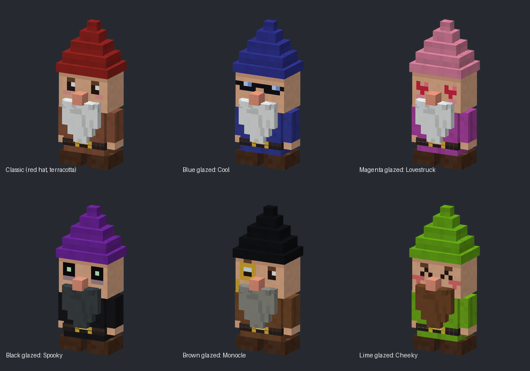
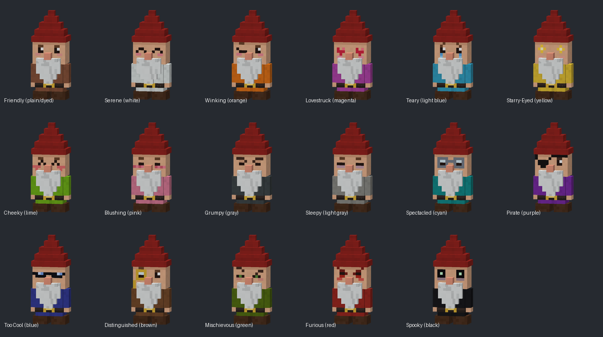

# Cheat Gnome

A throwback to the cheat gnome from The Sims. Craft a little garden gnome statue, put it somewhere, and
right-click it. With cheats on, it opens a cheat menu. With cheats off, it's a garden gnome that hands
out daily gifts, accepts offerings, and (if you let it) plays harmless pranks.

- **Minecraft:** Java Edition 26.3
- **Loader:** Fabric (requires [Fabric API](https://modrinth.com/mod/fabric-api))
- **Made for:** single-player (works on a LAN world too)

## Crafting

The gnome is a late-game trophy craft. The middle column builds the gnome itself; the corners are
the price of admission.

| | | |
|---|---|---|
| Diamond | **Wool** (hat) | Diamond |
| Gold Ingot | **Terracotta** (coat and face) | Gold Ingot |
| Totem of Undying | **Wool** (beard) | Echo Shard |

Turn on the **Nether Star Recipe** setting to swap the Echo Shard for a Nether Star.

The recipe is "special" (like map cloning or firework stars), so it doesn't show up in the recipe book.
Just lay it out in a crafting table.

### Dress your gnome

- **Top wool** sets the hat color. Any of the 16 colors.
- **Bottom wool** sets the beard color. White for a classic gnome, black or brown for a young one.
- **Terracotta** sets the coat and the face:
  - Plain or dyed terracotta gives a coat in that earthy terracotta tone with the classic **Friendly** face.
  - **Glazed terracotta** gives a bright coat in that dye color *and* its own face:

| Glazed | Face | Glazed | Face |
|---|---|---|---|
| White | Serene | Gray | Grumpy |
| Orange | Winking | Light Gray | Sleepy |
| Magenta | Lovestruck | Cyan | Spectacled |
| Light Blue | Teary | Purple | Pirate |
| Yellow | Starry-Eyed | Blue | Too Cool |
| Lime | Cheeky | Brown | Distinguished (monocle) |
| Pink | Blushing | Green | Mischievous |
| | | Red | Furious |
| | | Black | Spooky |

The gnome keeps its look when you pick it back up. Hover over it in your inventory to see its hat, beard,
coat and face.

**To pick the gnome up, sneak and break it.** Punching it without sneaking does nothing (except maybe annoy it).

## What it does

The gnome picks its behavior from the **Mode** setting:

- **Auto** (default): cheat menu if you have cheats on, garden gnome if you don't.
- **Always Cheats**: everyone gets the cheat menu.
- **Always Garden**: everyone gets the garden gnome.

### Cheat menu

Right-click with an empty hand.

| Cheat | What it does |
|---|---|
| rosebud / kaching / motherlode | 4 / 16 / 64 emeralds |
| Make All Happy | Full health and hunger, clears effects, puts out fire |
| freerealestate | Planks, stone bricks, glass and torches |
| Max Skills | +30 experience levels |
| Daytime / Nighttime | Sets the time |
| Clear Skies / Make It Rain | Sets the weather |
| Toggle Flight | Creative-style flight in survival |
| Fix Everything | Repairs every damaged item in your inventory |
| Instant Harvest | Grows nearby crops to full size |
| Gnome Gift | A random gift from the gift table, no waiting |
| Settings | In-game settings (cheats on only) |

### Garden gnome

- **Daily gift:** right-click with an empty hand once per Minecraft day (20 real minutes) for a random gift.
  Usually something handy like emeralds, iron, bone meal or food, and once in a while a diamond or golden apple.
- **Offerings:** right-click while holding something.
  - **Flowers** → garden goodies (bone meal, seeds, saplings, berries, rare seeds)
  - **Gold, emeralds, diamonds, amethyst** → something shiny (a Gold Block counts as nine offerings)
  - **Treats** (cookies, cake, pie, berries, honey, golden carrots, apples, bread, stew) → a random blessing
    like Speed, Haste or Luck, plus a little XP
  - **Rotten flesh, poisonous potatoes, spider eyes, bones or dirt** → the gnome is offended
  - Anything else: the gnome isn't interested and you keep the item.
- Sneak while holding a block to place it against the gnome as normal.

### Mischief (off by default)

Turn on **Mischief** in the settings and the gnome may prank you when you punch it, insult it with a bad
offering, or leave it alone for three days or more. Nothing here breaks blocks, hurts you, or takes items:

- **Fake Explosion:** a big bang and smoke, no damage
- **Wandering Gnome:** it hops to a new spot nearby
- **Creepy Stare:** it turns to face you wherever you go for two minutes
- **Chicken Ambush:** five chickens pop out around you
- **Rain Cloud:** a little cloud rains on you for 30 seconds
- **Pumpkin Head:** a carved pumpkin on your head (only if you're not wearing a helmet)
- **Decoy Gnomes:** fake gnomes appear and vanish in a puff when touched

Each prank can be turned on or off on its own.

## Settings

Change settings in-game from the cheat menu's **Settings** button (needs cheats on), or edit
`config/cheatgnome.json` in your Minecraft folder:

| Setting | Default | |
|---|---|---|
| `mode` | `AUTO` | `AUTO`, `CHEAT_MENU` or `GARDEN` |
| `giveGnomeOnFirstJoin` | `false` | Every player gets one gnome the first time they join a world |
| `netherStarRecipe` | `false` | Nether Star instead of Echo Shard in the recipe |
| `dailyGift` | `true` | |
| `giftCooldownTicks` | `24000` | 24000 ticks = one Minecraft day |
| `offerings` | `true` | |
| `mischief` | `false` | Master switch for pranks |
| `neglectDays` | `3` | Days without a visit before a lonely gnome starts pranking; 0 turns this off |
| `prankFakeExplosion` … `prankDecoys` | `true` | Individual pranks |

## Building

The repository includes a GitHub Actions workflow (`.github/workflows/build.yml`). Every push builds the
mod. Open the **Actions** tab, click the latest run, and download **cheat-gnome-jar** at the bottom.
The `.jar` inside goes in your `mods` folder or up to Modrinth.

To build locally instead, install Java 25 and run `./gradlew build` (`gradlew.bat build` on Windows).
The jar ends up in `build/libs/`.

## License

MIT
